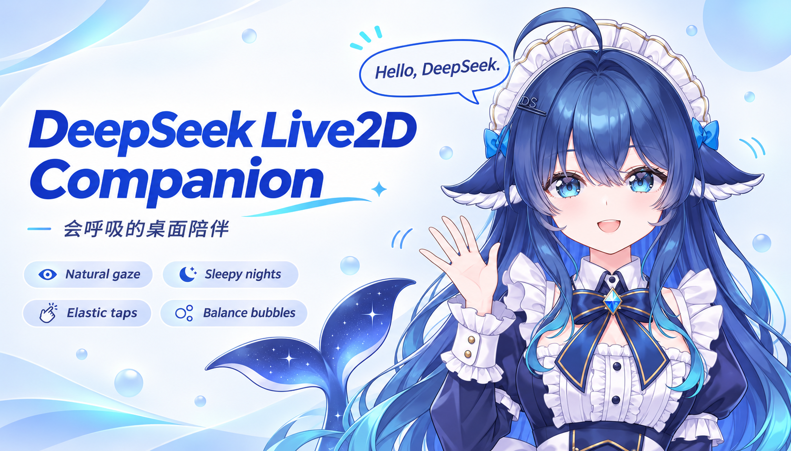
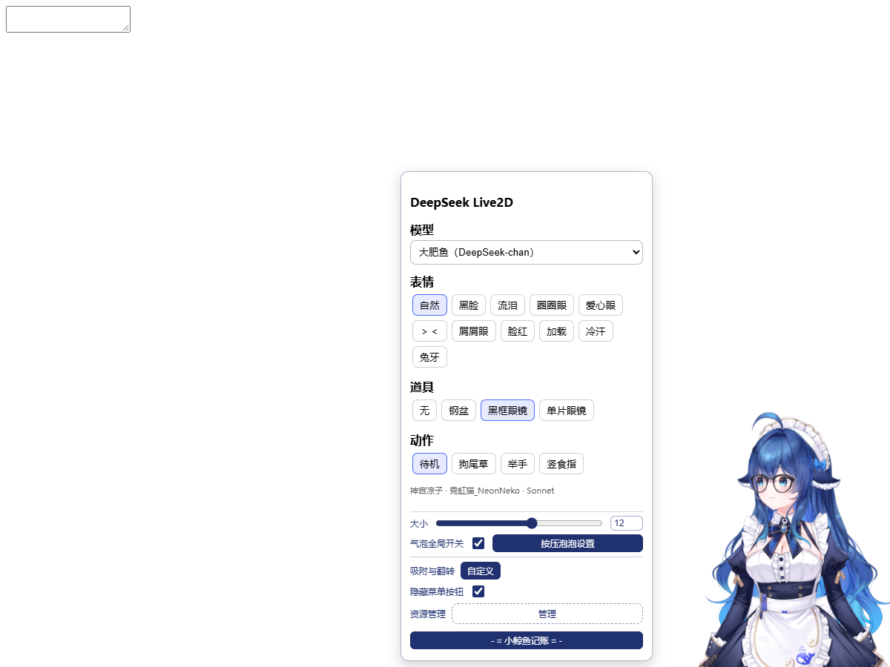

<div align="center">

# DeepSeek Live2D Companion

**让大肥鱼住进 DeepSeek Harness。**

自然呼吸与目光 · 点击 Q 弹 · 深夜困倦 · 对话气泡与余额记账



</div>

大肥鱼会看向鼠标，也会偶尔移开视线；夜深时慢慢眨眼，轻轻低头。点一下，她会随着小黄鸭音效 Q 弹，并短暂变成「＞＜」。余额、今日已用和每轮消耗，放在她身旁的小气泡里。

## 功能一览

| 陪伴与交互 | 表现 |
| --- | --- |
| 自然待机 | 呼吸、头部轻摆，头发和尾巴跟随模型物理响应 |
| 自然视线 | 鼠标静止后，偶尔眨眼、移开视线，再自然看回来；移动鼠标恢复跟随 |
| 深夜困倦 | 北京时间 **23:00–05:00**，偶尔慢眨眼、轻轻低头 |
| 点击 Q 弹 | 约 **0.6 秒**轻压回弹，短暂显示「＞＜」，随后恢复原表情，道具保持不变 |
| 长按拖拽 | **0.3 秒后**出现蓝色进度环，**0.7 秒**解锁拖动，松手后带阻尼停稳 |
| 气泡与记账 | 自定义文字、图片和点击序列；显示余额、今日已用、峰谷提示及每轮消耗 |
| 回复表情 | 根据本机 DeepSeek 回复的语气关键词切换脸部表情，不额外调用 API |

动画跟随屏幕刷新，切到后台暂停绘制。透明区域可以点穿；缩小窗口时模型会留在可见范围，放大后恢复原边距。

## 使用预览



## 怎么操作

| 操作 | 效果 |
| --- | --- |
| 单击模型 | Q 弹与短暂闭眼，同时显示或切换气泡 |
| 右击模型 | 在模型旁打开菜单 |
| 点击菜单外空白 | 关闭菜单 |
| 长按满 0.7 秒后移动 | 拖动模型，可向上拉出完整身体 |
| 进入「按压泡泡设置」 | 编辑内容、样式、文字与图片模块 |
| 进入「小鲸鱼记账」 | 查看模型费用、近七天与更多消费记录；点击「返回」回到主菜单 |

默认大小为 **12**，在窗口右下角显示上半身。菜单中的模型下拉框是预留切换界面，目前仅提供大肥鱼。

## 表情、道具与动作

- **表情**：自然、黑脸、流泪、圈圈眼、爱心眼、＞＜、屑屑眼、脸红、加载、冷汗、兔牙。
- **道具**：无、钢盆、黑框眼镜、单片眼镜。
- **动作**：待机、狗尾草、举手、竖食指。过渡与复原由插件处理。

## 安装

这是 DeepSeek Harness 的 **Cordis bundle 插件**，入口文件为根目录中的 `package.json` 与 `cordis.patch.yml`。

1. 下载仓库或 ZIP，解压到一个固定目录，保留完整目录结构。
2. 在 Harness 中让助手安装这个本地插件目录，例如：

   > 请把 `D:\Plugins\dsh-live2d-companion` 作为本地插件安装到当前 Harness 桌面配置，并启用它。

3. 刷新聊天界面即可使用；新增资源仍未加载时，在任务空闲后重启 Harness。

当前桌面安装采用 `link:` 本地目录方式。插件应作为 **`dsh-live2d-companion`** 加载；它已经包含气泡和记账逻辑，请勿与原 `dsh-whale-widget` 同时启用。

### 模型与私有备份

当前打包版随附本机大肥鱼模型，优先读取插件内的 `assets/model/`，解压后无需另改模型路径。此版本用于**私有仓库备份与个人本机使用**；请遵守原作者配布说明，不要公开重新分发完整模型。

模型目录保留 `大肥鱼.model3.json`、`大肥鱼.moc3`、`大肥鱼.physics3.json`、`大肥鱼.4096`、`Exp3` 与 `Animation` 等原始结构。当包内模型不存在时，兼容原本机路径：

```text
E:\KimiWork\DeepSeek免费公皮\DeepSeek
```

插件包不包含用户账户、API 密钥或本机消费记录。若向他人介绍模型，请分享原作者配布渠道，让对方自行获取。

余额显示使用 Harness 已有的 DeepSeek 账户或 API 凭据。不要把密钥写进 README、代码或聊天内容。

## 署名与许可

- **模型原画及拆分：神宫凉子**
- **Live2D 建模：霓虹猫_NeonNeko**
- **插件整合署名：Sonnet**
- **气泡与记账基础：MeteorNOX · [DeepSeek Balance Whale Widget](https://github.com/MeteorNOX/DeepSeek-Balance-Whale-Widget) 0.3.17**

插件代码沿用 MIT 许可，见 [LICENSE](LICENSE)。模型和美术、音效等资源不属于代码 MIT 许可的授权范围，详见 [PROVENANCE.md](PROVENANCE.md) 及各资源原始许可。模型配布说明禁止擅自重新分发完整模型，请分享作者的原始获取渠道。

---

<sub>所有陪伴效果在本机运行，账户与 API 凭据由 Harness 管理。</sub>
